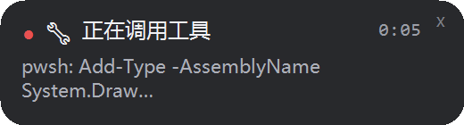
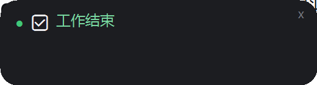

# dsh-live-thinking

> DeepSeek Harness 插件：**桌面置顶悬浮窗**——模型此刻在思考什么、在跑哪个工具、还是卡在重试里，一眼可见。

> **2026-11-07 变更**：输入框下方那一行实时状态（`🛠 pwsh 运行中 0:00` 那种）已按用户要求删除。
> 插件现在只做悬浮窗的数据源，界面里不再渲染任何东西；悬浮窗逻辑保持原样。
> 回滚：用同目录的 `client.js.bak-20261107-180503` 覆盖 `client.js`，然后**重启应用**。
> （改过插件源文件后不要直接刷新页面：应用启动时缓存了脚本的 rev，页面刷新会 404 并弹「应用无法启动」，点「重启」即恢复。）

自带的状态只有一句静态文案「深度求索中，用时 N 秒」：模型在思考、`bash` 跑了三分钟、审批在等你、请求在重试，看起来一模一样；上一条工具结束后提示还会停在旧内容上。这个插件把「当前阶段 + 最新一行思考」写出来，并且**每秒**刷新。

## 效果

**桌面悬浮窗**（置顶、可拖动，260 逻辑像素宽）——工作中：



| 元素 | 说明 |
| --- | --- |
| 指示灯 | 🔴 红 = 这一轮正在工作（思考、调工具、输出都算）；🟢 绿 = 工作结束 |
| 图标 + 标题 | 当前阶段：`思考中` / `正在调用工具` / `等待模型响应` / `输出中` / `请求重试中` |
| 计时 | 从**当前阶段的起点**算起，不是整轮，所以不会出现「思考中 15:52」 |
| 详情 | 最新一行思考，先压平换行，超过 **40 字**截断并以 `…` 结尾，最多两行 |

回合结束（收到 `running:false`，或 15 秒没有心跳）会转绿并显示「工作结束」，停留 **20 秒**后自动消失：



**~~输入框下方的一行~~（已删除）**：下面这段描述的是历史形态，保留作参考——
`client.js` 现在只推导状态并推给悬浮窗，不再渲染这一行，也不再注入任何 CSS。


| 显示 | 含义 | 数据来源 |
| --- | --- | --- |
| `♻️ 请求重试中（第 N 次）` | 请求在重试——长时间静默的真实解释 | `useProjection('llmRetry')`（缺失时退回 `sessions.binding(id).session.projections.faceOf('llmRetry')`） |
| `🔧 <工具>: <参数> 运行中 1:23` | 有工具在执行；最旧的那个优先，多个时标「另有 N 个」，计时是**该工具自己的** | 聊天快照 `legacy.runningCalls` |
| `🧠 思考中：<最新一行>` | 模型正在流式推理；取推理文本里最新的一行，超长从头部截断 | 聊天快照 `legacy.partial.blocks` 的 `reasoning` 块 |
| `✍️ 输出中 0:42` | 正在流式输出答案 | `legacy.partial` |
| `🧠 等待模型响应 0:42` | 回合在跑，但还没有内容到达 | `legacy.turnTimings` + 1 秒时钟 |
| （什么都不显示） | 没有运行中的回合 | `useSession` 的 `running` |

悬浮窗和（曾经的）那一行共用同一份推导结果：文本变化按 250ms 合并、每 3 秒补心跳；阶段计时从**阶段切换**算起，而不是整轮，所以不会出现「思考中 … 15:52」这种吓人的读数。

## 两个进程，一条本机链路

```
client.js（浏览器，已加载的插件）
   │  POST http://127.0.0.1:17863/state   （text/plain + no-cors，免预检）
   ▼
overlay.ps1（PowerShell + WinForms，置顶小窗）
   · 每 150ms 收一次状态，自己算计时
   · 15 秒没有心跳就隐藏（页面关了不会留残影）
   · 位置记在 %TEMP%\dsh-live-thinking\window.json
```

- **为什么小窗不放在 DSH 宿主里**：DSH 宿主是以 Node 模式跑的子进程，拿不到 Electron 的窗口 API；小窗必须是独立进程，也就顺理成章地不依赖宿主重启。
- **为什么状态从浏览器来**：只有浏览器能看到流式推理的增量，宿主会话日志里只有成型的 `assistant/message`。
- 监听只在 `127.0.0.1:17863`，不写任何配置文件，状态只在内存里。

## 安装

```powershell
# 1) 装插件（输入框下那一行）
dsh plugin --profile desktop add link:C:\Users\lenovo\Desktop\dsh-live-thinking

# 2) 启动桌面悬浮窗（现在就跑，不占终端）
wscript.exe "C:\Users\lenovo\Desktop\dsh-live-thinking\start-overlay.vbs"
```

**默认不自启**：每次开机后想用悬浮窗，双击上面的 `start-overlay.vbs`（或跑那行 `wscript.exe`）即可。想让它在登录时自动出现，再把启动器复制进 Startup：

```powershell
Copy-Item "C:\Users\lenovo\Desktop\dsh-live-thinking\start-overlay.vbs" "$env:APPDATA\Microsoft\Windows\Start Menu\Programs\Startup\dsh-live-thinking.vbs"
```

关闭小窗：点卡片右上角 `×`（本轮不再出现，下一轮再显示），或结束那个 `powershell.exe` 进程。

卸载：

```powershell
dsh plugin --profile desktop remove dsh-live-thinking
Get-CimInstance Win32_Process -Filter "Name='powershell.exe'" | Where-Object { $_.CommandLine -match 'overlay\.ps1' } | ForEach-Object { Stop-Process -Id $_.ProcessId -Force }
```

## 实现要点

- 入口：`conversation.composer.dock`（会话级 list 槽，内置统计行占的就是这里）。本插件 `order: -1`，并给 `[data-composer-dock]` 补一条 `flex-wrap: wrap`，因此它独占一行、显示在统计行上方。
- 组件只用槽里发下来的 `useSession` / `useChat` / `useProjection` / `t`；文本随聊天快照的每次增量自动重渲染。
- `overlay.ps1` 刻意保持**纯 ASCII**（Windows PowerShell 5.1 会把无 BOM 的 .ps1 按 ANSI 读），所有中文和 emoji 都从 JSON 负载或 Unicode 码点来；布局按 `DpiX/96` 手工缩放，200% 缩放下文字依然清晰。
- 悬浮窗宽度 260 逻辑像素（520 物理，2x 屏），`Short-Passage` 负责把思考压成一行短句 + `…`；结束态的停留时长是 `$script:doneMs`（默认 20000 毫秒）。
- 红绿灯：只要这一轮还活着（`running:true`）就是红灯；收到 `running:false` 或心跳超时 → 绿灯 + 「工作结束」，20 秒后隐藏。点 `×` 可立即隐藏，下一轮重新出现。
- 小窗不抢焦点（`WS_EX_NOACTIVATE`），整张卡片可拖动。
- `test/live-thinking.test.mjs` 覆盖状态优先级、工具计时、思考行提取与截断、时长格式。

## 测试

```powershell
node --test test/live-thinking.test.mjs
```

## 目录

| 文件 | 作用 |
| --- | --- |
| `package.json` | `dsh.bundle.patch` 与 `dsh.client` 声明 |
| `index.js` | 宿主半边：no-op（链路不需要宿主参与） |
| `client.js` | 客户端半边：订阅快照、渲染输入框下那一行、把状态推给悬浮窗 |
| `overlay.ps1` | 置顶小窗：监听 17863、渲染卡片、记忆位置 |
| `start-overlay.vbs` | 无窗口启动器（双击即启动小窗；需要自启时复制进 Startup） |
| `cordis.patch.yml` | bundle 补丁：插入本插件的 loader 行 |
| `test/live-thinking.test.mjs` | 纯函数单元测试 |

## License

MIT

## 作者

kongxiangrui,ciallo(∠・ω)⌒☆
